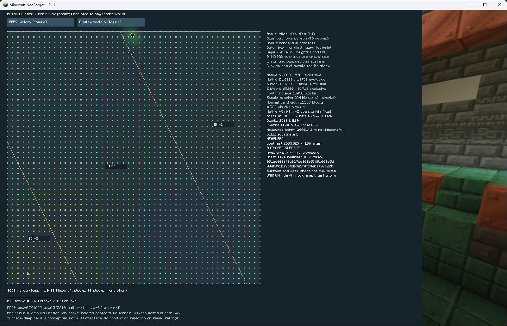

# Exact retained panel verified in Minecraft (#11)

**The existing PR58/59 panel works in a real, isolated Minecraft client without
TD.** No display source, retained record, contact, coordinate, history or production
selection changed. This is diagnostic display verification, not player recognition,
geological validity, gameplay acceptance or a production region generator.

Started from merged PR60 `bdd71fd`; fetched origin/main matched and GitHub confirmed
the merge. Read AGENTS.md, the retained-map/story contracts/evidence and carried
history/numerical gates. #9/#11 were independently confirmed open. Pre-existing
untracked viewer repairs and unrelated temp/ preserved. The [contract and executable
launcher](td-client-map-protocol.md) were pushed at **b1b5f1c before implementation**;
compiled isolated configuration/preflight corrections pushed at69f60c7 before
launch. Package correctiond610d4d preceded the two completed clients.

## Isolation and route

`diagnostics/retained-client` is an independent Gradle project with pinned
Minecraft1.21.1/NeoForge21.1.251 and no TD dependency. It directly compiles only
the existing `RetainedMap.java`/`RetainedMapScreen.java`, plus four diagnostic
classes; its only retained resource is the immutable TSV. No production source
set, addon JAR, runtime acceptance probe, production mixins, model/provider/ONNX
classes or model files enter its launch. Source/resource hashes match PR60 exactly.
The normal development and acceptance-client routes include TD and were not used.

The bounded launcher uses only the installed, SHA256-pinned NeoForge manifest,
validates library SHA1s, scans all supplied JAR entries including nested JARs,
whitelists display class prefixes, rejects inherited JVM injection variables and
creates a new disposable game directory with only the display mod. It never reads
credentials or copies profile options, saves or models. The title offers only
map and quit. Required diagnostic mixins block world/save access before opening
a world, non-null client-world attachment and integrated-server startup. Runtime
debug logs confirm all three mixins applied. These guards do not edit or weaken
production guards. Vanilla registries/textures and title panorama load normally;
the panorama is a bundled image, not observed terrain.

Structural exclusion is the absent executable TD/provider/model code, isolated
mod discovery and blocked world routes. Runtime class-load logs supplement it:
no TD/ONNX/production domain classes loaded. No world was created or queried and
no save file was written. Vanilla creates empty saves directories during startup;
those are retained, not continuing worlds. Normal disposable options/log/config
writes occurred. No source profile settings or world identity were used or changed.

Build without launching:

```powershell
$env:JAVA_HOME='C:/Program Files/Java/jdk-21'
.\gradlew.bat -p diagnostics/retained-client build --offline
& 'C:/Users/digif/.cache/codex-runtimes/codex-primary-runtime/dependencies/python/python.exe' scripts/launch-retained-client.py --check-only
```

The launcher is executable, but **this contract's three-attempt budget is exhausted**.
Do not remove its ledger or launch again under this budget. A later repeat needs
separate authorization/budget; no need to repeat it to package evidence.

## Actual client observations



[PR58, same native sample and scale](evidence/td-client-map-pr58.jpg) ·
[1200×900 / GUI1](evidence/td-client-map-small.jpg) ·
[Unsupported gap](evidence/td-client-map-gap.jpg) ·
[Exact action record](evidence/td-client-map-actions.json)

The images are actual Minecraft window captures via the Computer Use skill,
not separate renders. Computer Use returned JPEG bytes; original raw .png names
are retained in the ZIP, with correct .jpg extensions on these identical copies.

At1600×1000/GUI2, entry, exposure native2944,13824 (PR59 ID-3), both comparison
directions preserving that site, scale1→6 preserving it, cover records at
2688,10880 (ID-2) and5760,10880 (ID-1), full two-line shared tokens, gap and exterior
clicks, Escape, reopen and quit all worked. Reopen creates fresh transient display
state (PR59/scale1/first site); it saves no selection. At1200×900/GUI1, entry,
same exposure, scale/comparison preserving the sample, gap, Escape and quit worked.
This is two configurations, not a claim about every GUI scale/window size.

Both show native axes/bounds, Minecraft block/chunk distances, half-open footprint
and unknown gaps/exterior. Scale1/6 labels show side3073/18438 blocks,
spacing64/384 blocks (4/24 chunks), nominal width2048/12288 blocks
(128/768 chunks **along X**). At scale6 exposure coordinates are17664,82944,
chunks1104,5184, local0,0. Cards separate seed, measured descriptors, authored
surface, inherited deep token and uncertainty. Both full token halves fit.

Visual judgment: qualified yes, regional size, conceptual contacts and shared
surface/deep identity are legible in Minecraft. The gold contacts, labeled IDs,
distance notes and exposure/cover cards make that diagnostic story inspectable.
Text is small; no clipping observed in either configuration. The unchanged
fixed-aspect canvas leaves a title-panorama strip at the right of1600×1000.
GUI scale changes do not enlarge the fixed-canvas map font. No display repair
was needed or made; this is not a responsive-layout/accessibility certification.

**PR59's negative result remains:** terrain-dependent authored history and connected
regions did not establish better landscape-related contacts. Its straight lines
visibly cut curved relief; PR58 has a bent contact but retains its horizontal seam.
This display verification neither rescues that rule nor validates geological history.

## Budget, failures and evidence

Three attempts consumed:31.640s loading failure,90.953s completed GUI2 client,
65.390s completed GUI1 client; total187.983s below2700s, each below900s.
Attempt1 reached the actual error UI because Diagnostic was inside the mixin-only
package. Moving only the three mixins into a subpackage fixed it. All partial
logs, source/artifact and screenshot remain. Minecraft returned exit0 even on
that error screen: the report/exporter classifies it as a **failed attempt**.
Final launcher additionally requires panel entry/no fatal log; those reporting
and serial-ledger checks are offline-reviewed, not another runtime launch.

Heap2GiB each; sampled working set/disk/free-space limits held. Exact maximum,
monitor samples, executed commands, immutable source/resource/JAR bytes, mod
entries, dependencies, full console/latest/debug/class-load logs and screenshots
are in the [portable archive](evidence/td-client-map.zip) and
[SHA256 manifest/results](evidence/td-client-map.json). Native DLLs and shared
Minecraft libraries are inventoried/hashed, not redistributed.387 post-run
dependency hash checks match original bytes; pre-existing viewer-repair hashes
match. All three exact client PIDs are absent after UI quit and no Minecraft
window remains. No background display worker or game server was started.

Computed checks are distinct from observation: portable hashes/logs verify
immutable inputs, absent forbidden loaded classes, required mixin application,
no save files and sampled caps. They do not compute human readability or prove
in-world recognition. Existing retained-record tests and pure-JDK map checks
verify signed/chunk-edge conversion, complete records, tokens and hit testing;
they use retained data only. No new terrain, seeds or numerical experiments.

New verification: isolated build/Java retained check; normal build/probe/domain/
settings/coarse checks; five portable tests including corrupt record, forbidden
loaded class, missing guard and save-file rejection. Existing retained suite,
resource/catalog and strict historical replay also run. CI compiles/checks this
route and replays packaged evidence; it does not open Minecraft. Final CI, merge
and strict retained/new re-export after final Windows checkout are recorded on
the PR. Reused continuing-save/529-container/runtime evidence was not rerun.

## Recommendation and unchanged gates

Keep this exact panel as a development inspection route. The display question is
answered; another map framework or regional construction is unnecessary here.
The smallest remaining step toward a visible terrain-aware addon is a separately
scoped, read-only **in-world diagnostic overlay for this same retained fixture**,
with explicit support/identity labeling and its own world/startup budget. That
would test whether block/chunk distances and contacts can be understood while
moving in Minecraft; it would not adopt PR59 for block selection. No such world
or TD execution is authorized or performed here. A useful production rule still
needs its separately frozen terrain-support/uncertainty/joining contract.

All [PR60 carried-forward gates](td-retained-map.md#carried-forward-gates) remain:
PR57 reduction, PR51 `Paired coarse drift`, PR52 `Actual matching native support
changed`, height/residual criteria and #5's stronger final-block assertion stay
failed. Geometry/uncertainty, historical numerical cause/reproducer, multi-field
joining, fresh validation and paired startup/cold/warm/full-route performance
remain unresolved. PR54's four TD launches stay exhausted; executed4a2fa1c,
final capture mixin compile-only, historical arrays/indices/ULPs unavailable.
Adoption still needs versioned identity, explicit new-world selection,
bidirectional continuing-save rejection, exact restoration/reopen and complete
snapshot/block/persisted-container preservation. Geology-1, production selection,
strict guards, immutable inputs and optional Ulti-World unchanged. No fresh
seeds/observations, replacement histories, parameter search, palettes/dikes/
minerals/integrations or migration. **#9/#11 remain open.**
