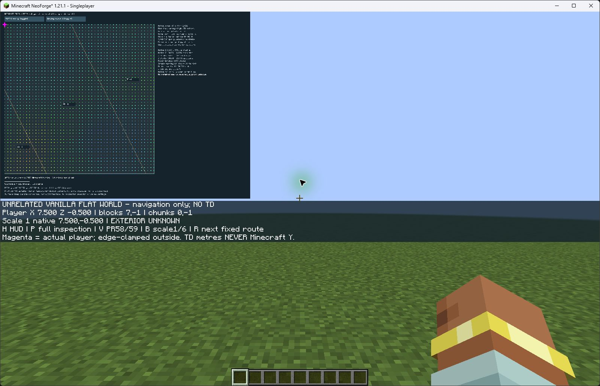

# navigation-3 sole slot consumed; startup monitor failure

After fresh explicit authorization/presence at pushed435de09, identical literal
argv and the unchanged951fcda freeze passed the immediate same-process preflight.
Allocation consumed the sole navigation-3 slot. A one-second process identity
query timed out during startup; the frozen collector failed closed and forcibly
cleaned up Java27824 and descendant9140. Exact identity absence and empty job were
recorded. No input, route, captures or normal shutdown occurred; all18 checklist
rows remain not observed and acceptance is INCOMPLETE. No retry or replacement.
See [current outcome](td-navigation-3-outcome.md), [portable partial root](evidence/td-navigation-3-runtime.zip)
and [computed replay](evidence/td-navigation-3-runtime.json). PR62 remains draft
and unmerged; all historical failures and carried gates remain unchanged.

# Historical authorization stop before allocation

The user subsequently authorized ONE attempt including failure at prepared
951fcda and freshly confirmed presence. The invocation stopped at the frozen
literal argv guard: the agent recorded a backslash authorization-file argument
but supplied forward slashes. `ValueError: Authorized command differs` occurred
before installed-profile preflight, allocation or Java creation. No retry or
collector revision followed. Runtime root remains absent; the slot is unconsumed,
and this stopped invocation does not authorize another. All live evidence remains
missing. See [retained stopped outcome](td-navigation-3-outcome.md) and
[portable external record](evidence/td-navigation-3-stopped.json).
PR62 stays draft/unmerged; historical failures and all carried gates remain.

# Single-attempt preparation (historical preparation status)

User authorized preparation on2026-11-12. [navigation-3 frozen protocol](td-navigation-3-protocol.md),
[exact manifest](td-navigation-3-hashes.json), executable launcher/recorder/replay,
action/approval schema and portable preparation are separately reviewable.
Independent one-slot root/ledger is NOT created. Both old budgets/failures remain
unchanged. Existing decimal-corrected artifact is reused byte-for-byte beneath
the new independent root using its required inner td-navigation-2/attempt-01
suffix; no adapter rebuild or local Java execution is needed. Windows suspended
creation/job containment remains offline mock-tested only. Full checklist and
human visual review, not exit0/readiness/CI, determine later acceptance.

Reconciled origin/main513c4ca and GitHub open/draft/unmerged PR62 atc91c76b;
build/offline CI run43177941172 passed at that prior head. Viewer repairs and
unrelated temp preserved. [Preparation results](td-navigation-3-preparation.md)
distinguish new offline checks from historical runtime evidence. No installed
preflight, attempt allocation, Java/Minecraft/TD launch, save reopening, new seed
or terrain observation occurred. PR59 negative contacts and every carried gate
below remain unchanged; PR62 draft/unmerged and #9/#11 open.

# Retained navigation attempt: acceptance failed (#11)

## Future-proposal review only (no budget implemented)

Fetched origin/main remains513c4ca; local HEAD, remote navigation branch and
GitHub PR62 head agree atc57ca8a before this documentation revision. GitHub
confirms PR62 open/draft/unmerged and build/offline CI run42574078432 successful
at that commit. Existing untracked viewer repairs and unrelated temp/ are
preserved. Historical strict replay results below remain historical results;
this guidance-only review does not rerun clients, readiness or retained exports.

Reviewed the [future proposal](td-navigation-future-proposal.md) against both
frozen navigation contracts, decimal amendment/hash manifest, readiness records,
portable actions/replay, launcher and carried gates. Narrow additions make the
decision concrete: separate preparation/execution approvals; present-human and
same-context preflight conditions; per-check live evidence; independent panel
selection (P does not inherit the HUD model); bounded schedule with shutdown
reserve; exact parent/descendant cleanup evidence and failure disposition.
No executable, launch budget, ledger, artifact or frozen contract is changed.

One attempt could finish the existing retained-display inspection within1200s
if client entry, exact setup and human/capture handoffs work. It cannot be
promised: Python IPv4 does not establish Java/Netty, and decimal setup, full
route/controls, readable panel/return/configurations and normal server shutdown
remain unmet. Missing any required evidence keeps acceptance incomplete, with
no replacement slot. Revised launcher still has never launched a client.

Next decision is whether to authorize preparation of that one-attempt collector
and frozen protocol. Execution needs a separate explicit client approval after
the exact collector/protocol/hashes are pushed and reviewable, a present human,
named approved context and successful immediate preflight in that context.
Non-client permission is not client permission. No launch, allocation, save
reopen, TD execution, seed or terrain observation occurred in this review.
PR62 stays draft/unmerged; PR59 negative contacts and all carried gates remain.

## Non-client loopback readiness revision (no new launch authorization)

Reconciled fetched main513c4ca, GitHub draft/open/unmerged PR62 and brancha17feef.
Only pre-existing untracked viewer repairs and unrelated temp/ were present;
they remain preserved. Both navigation budgets remain exhausted, all historical
failures below remain failures. No Minecraft/TD process, world reopening, new seed
or terrain observation occurred during this revision.

The supplemental launcher now performs one ephemeral IPv4 127.0.0.1 TCP handshake
before any attempt directory, ledger allocation or client process. Bind uses port0;
listen backlog1; connect/accept/send/receive each have fixed1s timeouts, no retry,
all sockets use context-managed cleanup (at most4s blocking socket operations,
excluding OS scheduling). Failure raises a clear no-slot-consumed error. --check-only
performs the readiness test and existing hash/isolation checks without allocation.
No downloads, firewall/security changes, undocumented APIs or automatic escalation.
Existing launch-budget/hash/isolation guards are unchanged.

New explicit non-client observations: restricted --check-only failed in0.029s
with WinError10013; separately approved --check-only passed in0.403s, including
installed-library/nested-JAR and exact isolated artifact/source checks. Both frozen
ledger SHA256 values and both attempt-directory lists matched before/after in each
context. [Portable readiness evidence](evidence/td-navigation-readiness.zip) retains
the exact newly tested launcher, collector, tests and both context records.
Four readiness regression tests cover pre-allocation failure for check/launch modes,
socket timeout/cleanup, successful cleanup and preserved budget-guard expressions.
An initial test fixture failed due to restricted system-temp access; the fixture
now uses a temporary directory within the repository root and passes. CI also
caught the intermediate fixture's assumption that runs/acceptance already exists
on a fresh checkout; using the always-present repository root fixes that failure.

This narrows a local permission obstacle; it does not establish Java/Netty selector,
IPv6, world entry, movement, UI or shutdown readiness. The new launcher has been
executed ONLY through non-client checks; it has never launched a client. The
supplemental portable archive updates its top-level current launcher member only;
raw attempt executed launcher bytes and all historical outcomes/actions remain
distinct and unchanged. Navigation acceptance remains INCOMPLETE, PR62 draft.

[Future single-attempt contract proposal](td-navigation-future-proposal.md) is
separately reviewable and grants no authorization. Smallest next step: review that
one-attempt proposal with a present human for held movement, then, only if explicitly
authorized, finish the same frozen retained-display inspection. No new geological
construction is needed for this gate toward a visible terrain-aware addon. PR59's
negative contacts and every carried gate at the end of this report remain unchanged.

## Final supplemental slot: world entry failed; budget exhausted

Reconciled GitHub/main513c4ca and branch4b5c2e2 before launch. Fixed source hashes,
installed dependency scans, exact decimal-correction JAR bytes, isolated build,
Java retained checks and seven portable tests passed. Viewer repairs and temp/
were preserved. Attempt2 consumed42.120 seconds; both navigation-2 slots are now
exhausted (169.089 seconds total). Navigation-1 remains exhausted and failed.

Actual observations:1600x1000 GUI2 title captured; clicked NEW navigation once.
Fresh-save and integrated-server guards ran, but world entry failed while Netty
created its event loop/selector: `Unable to establish loopback connection`, caused
by `SocketException: Permission denied: connect`. The restricted title returned.
The launcher ran under restricted execution; this local networking failure was
not caught by its hash-only preflight. No retry or permission-changed relaunch
was made. No player position, local attachment, teleport or movement occurred.
Decimal correction bytes loaded, but exact decimal setup remains unverified.

Clicked Quit diagnostic; client logged `Stopping!`, exited0 and launcher finalized
the failed route. Exact PID29076 was absent and supported window inventory showed
no Minecraft window. No child PID was observed. No `Stopping server` log exists:
normal local-server shutdown remains unverified. Exit0 is not acceptance.
Portable evidence retains both original failures and all final partial output,
executed bytes, monitor, inventory, dependencies and two actual title screenshots.
Post-run all129 dependency hashes and fixed retained/viewer inputs match.

No human hold was requested. All previously unverified route, HUD, panel, token,
configuration and shutdown checks remain unverified. No new visual judgment of
movement or contacts is possible. PR62 remains draft and must not merge.
No TD execution, seeds, observations, production changes or save migration.
All carried gates below and PR59's negative contact result remain unchanged.

Smallest next step: diagnose local loopback permission with a non-Minecraft,
non-TD readiness check before proposing any separately authorized client budget.
Then finish this same retained display gate; no new geological construction is
needed for that check. A visible terrain-aware addon still needs the carried
terrain interpretation, validation and adoption gates.

## Supplemental navigation-2: partial human-assisted observation

Historical attempt1 checkpoint below; its formerly remaining slot was consumed
by the final failure above. It is not an available launch authorization.

PR62 remains draft. [Supplemental contract](td-navigation-supplement.md) and
executable launcher were pushed at068c5cb before implementation/launch; artifact
path preflight repair at a81bf6e preceded the launch. GitHub PR metadata and fetch
confirmed main513c4ca and branch ed42ef0. Existing navigation-1 failures below
remain unchanged. No new TD execution or geological construction occurred.

The Windows tools support key taps, but neither supports held movement (CUA
explicitly rejects duration on Windows). The user agreed to supply held W.
One of two NEW navigation-2 attempts ran126.969 seconds; one remains unused.
Startup/world entry completed within180 seconds. Heap2GiB; sampled working-set,
disk/free-space and1200-second caps passed portable checks. Exact reused/planned
source/resource hashes were pushed with the contract. Only the isolated root
name changed before this attempt; PR61 and production barriers are untouched.

Actual client: fresh unrelated flat world,1600x1000 GUI2; HUD entry and short R
event control worked. Setup reached2944.5,13824.5 because vanilla centers integer
teleport X/Z. The unchanged exact-site rule correctly showed UNSUPPORTED GAP.
This is a setup failure, not a retained sample or approximate identity.
The user confirmed holding W and possibly moving the mouse slightly. Logs record
movement from2944.5,13824.5 to2922.054713,13824.447234, displacement22.445349 blocks,
blocks2944,13824 to2922,13824 and chunks184,864 to182,864. This is human-controlled
vanilla movement recorded by the client, separate from the setup teleport.

Title, HUD entry and before-movement images are retained. The next capture/H
operation was interrupted by physical Escape; no image or action result returned.
Do not claim H was delivered, HUD return, marker coherence or after-movement visual
verification. No further UI actions occurred. Exact command-line-checked PID2788
and child28560 were forcibly terminated; launcher finalized exit-1, partial logs,
inventory and failed route check. Exact PID queries afterward found both absent.
Normal local-server shutdown was NOT verified. The save is disposable and will
never be reopened. No after image exists; none is reconstructed or substituted.

Before any second attempt, the decimal-coordinate correction contract/hash was
pushed at19020e1; narrow source fix at196eccb appends .0 to the same fixed X/Z
setup commands. It compiles with Java retained-coordinate checks but has never
run. Panel, model, immutable resource, origin, histories and drawing are unchanged.
TD metres remain distinct from Minecraft Y. Final slot is preserved while the
user is unavailable; short tool inputs do not replace held movement.

[Portable partial archive](evidence/td-navigation-supplement.zip) ·
[computed checks and hashes](evidence/td-navigation-supplement.json) ·
[observations and limitations](evidence/td-navigation-supplement-actions.json).
The archive retains exact executed event-adapter source/JAR separately from final
compile-only decimal source/JAR, command/dependencies, class/guard logs, complete
position sequence, monitor, save/file inventories, original attempt contract and
hashes, cleanup and three actual-client screenshots. All129 supplied dependency
hashes, retained input archives and both pre-existing viewer repairs still match.
Forbidden executable/class scans and fresh-save/local-server guards pass offline
audit; no universal filesystem-write trace is claimed.

Seven supplemental replay/corruption tests cover byte replay, forbidden classes,
coordinates, continuing-save paths, immutable records, keyboard guard and cleanup.
Original navigation-1 portable failure checks remain separate. CI is build/offline
replay only. No merge or merged-main audit is justified without full acceptance.
Visual judgment remains limited: live coordinate/status lines readable, shrunken
HUD labels too small; movement's benefit for contacts/shared history is unassessed.
The full unchanged panel is still the intended readable history-card view.

Smallest remaining step: finish the same frozen route, exact-site decimal setup,
scale6 held movement, HUD/panel return, full token cards, configurations and normal
shutdown using the final slot with human held input or a supported held-key API.
This is a UI diagnostic gate toward a visible terrain-aware prototype, not a new
regional construction or evidence for PR59 contacts. All carried gates below,
geology-1, optional Ulti-World and #9/#11 remain unchanged/open.

## Original navigation-1 result (preserved)

**The no-TD client creates a disposable vanilla world and draws the exact retained
comparison, but the requested movement inspection is NOT verified.** Two launches
consumed the new budget, including failures. No further client or TD launch is
allowed under navigation-1. This work is a draft, not ready to merge as completed
navigation tooling. No gameplay improvement or adoption is claimed.

Reconciled fetched main and GitHub PR61 at513c4ca; #9/#11 remain open. Read AGENTS,
client-map/report/contract/portable evidence, retained-map/story and carried
observation/numerical protocols. Existing viewer repairs and unrelated temp/
preserved. [Contract and executable launcher](td-navigation-protocol.md) pushed
at9bafdec before implementation; first adapterc17f2a1 and login correctionbf85d6f
pushed before their respective launches.

## Implementation and isolation

Separate diagnostics/retained-navigation reuses the isolated PR61 project with
Minecraft1.21.1/NeoForge21.1.251 only. Original retained-client and production
code remain unchanged. It compiles the exact RetainedMap/RetainedMapScreen and
immutable TSV; no contact, sample, token, authored history or drawing changes.
The HUD adds player X/Z, floored blocks/chunks, inverse scale1/6 coordinates,
exact-site/gap/exterior labels and a magenta position marker. Outside markers
are explicitly clamped to the retained rectangle. No nearest-site identity,
height interpolation, Minecraft-Y conversion or production selection.

New diagnostic guards narrowly permit createFreshLevel for navigation-only
under the canonical newly allocated game directory, only while a creation
capability is active. Existing save, alternate name/root, redirected root and
subsequent creation reject. Startup requires fresh flag and the exact save;
world attachment requires the local integrated server. Title omits world browser
and multiplayer; after creation it omits creation/reopen. LAN publishing rejects.
The second build restricts disconnect UI as well. These replace barriers only
in the NEW project; PR61's original unconditional barriers are preserved.

The launcher checks installed manifest/library hashes, scans supplied/nested JARs,
whitelists diagnostic classes and rejects inherited JVM injection. No TD/ONNX,
provider/model files, production addon/hooks or source profile saves/options enter
the launch. Shared libraries/assets are read-only inputs; hash rechecks match.
Absence of executable TD bytes is the structural exclusion; class-load and guard
logs supplement it. No continuing save root is supplied or inspected by this mod.
The monitor inventories this run and rejects other save names; this is not an
OS-wide filesystem write trace, so do not claim universal external-write proof.

Vanilla flat preset, reused seed8675309, structures/bonus chest off, peaceful
creative, spawn radius0, render2/simulation5 and30fps. Vanilla chunks are unrelated
navigation context, NEVER retained TD terrain evidence. The HUD reads player
X/Z only; terrain heights and block states are not used. Fixed route teleports
use Y100 purely for navigation; they were NOT successfully invoked.

## Actual client evidence and failures

[Portable archive](evidence/td-navigation.zip) · [hashes/results](evidence/td-navigation.json)
· [exact action record](evidence/td-navigation-actions.json)
· [unchanged cover panel](evidence/td-navigation-panel-cover.jpg)

Attempt1 failed local login: reused display-only username RetainedDiagnostic has
18 characters, while login permits16. It created only its new disposable flat
save. Screenshot/logs retain the error. Ctrl-C interrupted the launcher; both
processes were confirmed absent, but finalization did not run. Original allocated
ledger is retained, final inventory was collected afterward, and the FULL1200s
slot is conservatively charged. Exact completion duration is unknown; monitor
samples are retained. This is a launcher cleanup limitation, not a passed case.

Attempt2 used RetainedNav and reached the world at1600x1000 GUI2. HUD showed
actual playerX7.5,Z-0.5, blocks7,-1, chunks0,-1 and EXTERIOR UNKNOWN, matching
signed floor ownership. Short R/P tool inputs did not trigger diagnostic actions;
P instead displayed vanilla social-interaction text. Short W produced no recorded
X/Z change. No fixed-route or overlay-toggle log exists. Escape/pause, save/quit
to title, unchanged default cover panel with both token halves, panel Escape and
normal quit worked. Server-stop logs, absent exact PIDs16300/29536 and no remaining
Minecraft window confirm cleanup. Exit0 is NOT movement acceptance.

Source diagnosis: render-time GLFW polling can miss press/release between frames.
Final adapter handles KeyboardHandler.keyPress events instead and consumes its
diagnostic shortcuts. **This correction builds, but was never run.** Do not
substitute final source for the separately archived executed polling source/JAR.
Short vanilla W also failed to move in this automation, so the input diagnosis
does not establish a fully solved movement route.

Unverified: HUD entry/exit/return controls, actual movement and marker coherence,
all retained route sites/edges/gaps, scale1/6 in-world behavior, same-site comparison,
exposure/cover inspection from a loaded world and alternate GUI/window settings.
PR61 panel interactions are reused evidence, not new navigation acceptance.

Visual judgment: the unrelated-world label and coordinate lines are readable;
shrinking the entire unchanged drawing makes HUD labels too small. The map renders
contacts, but **movement's benefit for regional size, contacts and shared history
cannot be assessed**. No player recognition, geological validity or gameplay claim.
PR59 remains negative: authored terrain-dependent history and connected straight
bands did not establish better landscape-related contacts.

## Verification, disposition and next step

Both attempts consumed, charged1338.391s/2400 (first1200 conservative, second138.391
measured), each within1200. Heap2GiB; sampled working-set/disk/free-space caps are
checked by portable replay, not claimed instantaneous bounds. New raw evidence
retains screenshots, complete logs/class loads, manifest/dependency hashes,
executed source/JAR, save/file inventories, samples, original and finalized ledgers.
Post-run dependency and viewer-repair hashes match. No TD execution or new TD data.

New checks: isolated final compile and unchanged Java retained coordinate/record
check; five portable evidence/corruption tests reject forbidden classes, alternate
save paths, modified records and missing guards. CI compiles/replays; no client.
Strict retained/new exports must pass after the final branch Windows checkout.
No final merged checkout exists because runtime acceptance failed; keep PR draft.

Smallest remaining step: verify the event-based controls and the already frozen
route in this same isolated world harness under a separately authorized finite
client budget; first address reliable held movement input and use the full panel
for text. No new regional construction or TD observations are needed to resolve
that UI question. Do not expand to another map framework or promote straight bands.

All carried gates in td-retained-map.md remain. PR57 reduction, PR51 `Paired
coarse drift`, PR52 `Actual matching native support changed`, old height/residual
criteria and #5's stronger final-block assertion stay failed. Geometry/uncertainty,
historical numerical cause/reproducer, multi-field joining, fresh validation and
paired startup/cold/warm/full-route performance remain unresolved. Adoption needs
versioned identity, explicit new-world choice, bidirectional continuing-save
rejection, exact restoration/reopen and snapshot/block/persisted-container safety.
PR54 four TD attempts exhausted, ran4a2fa1c; final capture mixin compile-only;
historical arrays/indices/ULPs unavailable. Geology-1, production guards/selection,
immutable inputs, optional Ulti-World unchanged. No new TD seeds/observations,
replacement histories, parameter search, numerical experiments, palettes, dikes,
minerals, integrations or migration. **#9/#11 remain open.**
