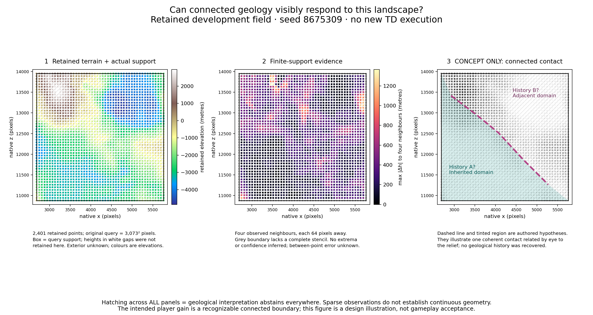

# One pressure reduction and a retained-terrain contact illustration (#11)

Diagnostic only. **The one frozen reduction fails. No runtime experiment is
justified or prepared; no TD execution occurred.** Geometry and numerical
adoption remain insufficient. Geology-1 and production sources are unchanged.

[Frozen protocol](td-pressure-visual-protocol.md) ·
[portable evidence](evidence/td-pressure-visual.zip) ·
[manifest/results](evidence/td-pressure-visual.json) ·
[visual image manifest](evidence/td-pressure-visual-image.json).

## Authority and what was actually performed

On 2026-11-07, fetched origin/main and local main both matched merged PR56
`d995cf8415927e9a3a5fc90eb769a48c09364f27`. GitHub independently confirmed #56
merged and #9/#11 open. AGENTS.md, PR56's report/protocol/portable traces and
PR54/55's reports/protocol/evidence apply. PR55 has no separately named protocol:
its reconstruction rules are in its report and archived executable sources.
The new selection protocol was committed and pushed at `92c94ea` before either
reduced arm was evaluated. No replacement candidate was evaluated afterwards.

Reused: PR52 terrain/metrics/public prefixes, PR53/54 outcomes/arrays and pinned
source/bytecode, and PR56's model and traces. Newly performed: offline lineage
tracing, the single paired reduction, descriptive sample differences, authored
visual annotation, portable tests and strict re-exports. These are not new
terrain observations, runtime acceptance, fresh validation or gameplay gains.
All inspected seeds and analytical controls remain development data.

The frozen model again passes all 100 PR52 command deltas, 104 absolute checks
and 69 PR53/54 checkpoints. Added tracing reproduces its exact batches,
evictions, totals and every pre-target cache order. The archive nests PR56's
original ZIP byte-for-byte and retains both complete new full-history traces
and both reduced traces. No upstream checkout or machine-local run is needed
for portable replay. The pinned CPU JAR remains
`3212b53cc1af656e37fb73511aa64f9623ea38e274705d102ce7cd9944092fe8`.

## Request ancestry and cumulative pressure

Rows are native z, columns native x; all request ordinals are zero-based.
**Observed runtime evidence** consists of public requests, aggregate counters
and old hashes. Internal creation/access/eviction events below are **source-derived
predictions** under the single retained startup hypothesis. Startup predicts four
coarse windows from [0,0,1,1]; only its four-window count was observed. Historical
startup order, unlogged concurrency and exact internal state remain unknown.
Counter agreement does not uniquely establish that state or any array bits.

Both full histories create the four distinguishing init keys during patch90:

| Keys | Exact creation batch at request90 | Coarse ancestry |
| --- | --- | --- |
| (-16,-8), (-16,-7) | [(-16,-8),(-16,-7),(-16,-6),(-16,-5)] | startup (-1,-1) |
| (-16,6), (-16,7) | [(-16,4),(-16,5),(-16,6),(-16,7)] | startup (-1,-1), then (-1,0) |

The first group's four ordered coarse slices start at (-17,-9), (-17,-8),
(-17,-7), (-17,-6), each 4x4. The second starts at (-17,3)..(-17,6), also
4x4. Those coarse dependency reads, including their cache promotion order and
creation provenance, are in the DAG. Both large patches (85 and90) influence
cache occupancy and subsequent ancestors; patch90's complete init groups are
not interchangeable with the later cell-read groups.

After patch90, init contains544 entries. In full scale1, requests91..237 create
910 more init windows and evict388, leaving1066 resident. Thus a single nearby
read is not the entire pressure history. At request237, the A keys occupy eldest
ranks12/13 and B keys26/27 (zero-based access order). Contains checks do not
promote them; actual getSlice reads do. Complete per-request membership/ranks,
ordered dependency reads and all per-slice eviction decisions are portable.
Serial provider-cache membership/access order is also retained after every
request and before each target; it is distinct from the tensor stores.

| Full scale1 trigger | Native public request | Init slice returning/evicting | Pressure at eviction |
| --- | --- | --- | --- |
| 238, event240 province anchor | [-7424,-1536,-7168,-1280] | [-992,-256,-928,-192] | 1084 ->1066 entries; removes18, including both A keys |
| 326, event280 A | [-3584,-1536,-3328,-1280] | [-512,-256,-448,-192] | 1076 ->1066; removes10, including both B keys |

These are post-assembly init evictions inside step dependency reads, not a
public provider-cache clear or an eviction at cache write. Scale6's corresponding
province-anchor request234 also removes18 init entries at the same slice, but
its older membership/order differs: it retains A at ranks2/3 and B at16/17
afterwards. It retains all four through A/B. Scale1 recomputes A in request326,
and that read itself evicts B before request366; A and B are not independent
fresh-process experiments.

At A, the full step batch is [(-16,-8),(-15,-8),(-14,-8),(-13,-8)] in both
scales; at B it is [(-16,7),(-15,7),(-14,7),(-13,7)]. Scale1 init groups are
4/4/2 versus scale6 4/4, with different exact members and dependency creation
ancestry. For example A's recomputation groups (-16,-8),(-16,-7) with
(-15,-9),(-14,-9), instead of their patch90 neighbors. At B, (-16,6) joins
[(-17,6),(-17,7),(-17,8)], while (-16,7) joins
[(-16,8),(-15,8),(-14,8)]. Exact all-stage batches and recursive dependency
reads are retained rather than inferred from group sizes.

## The one selected pair and its failed comparison

Scale1 ordinals: **85,90,231..244 inclusive,326,366** (18 requests).
Paired scale6: **85,90,231..240 inclusive,322,362** (14 requests).
Each uses the same source-derived startup and exact retained request objects.
The middle intervals contain every call of events238/240, not just their fine
reads. The archive retains exact bounds, flags, role and order for every call.
Any float hashes within those retained request objects describe the original
full-history observations, not predicted outputs of the reduced sequences.

This selection tests whether the two patches plus the local pre-eviction/eviction
episode suffice. It intentionally omits older accumulated pressure and the long
later prefix. No automatic minimization, parameter search, successive candidate
or altered startup was attempted. PR56's previous two-call failure is unchanged.

| Required comparison against each arm's own full history | Reduced scale1 A/B | Reduced scale6 A/B |
| --- | --- | --- |
| Distinguishing keys' complete creation/recreation ancestry | fail / fail | pass / pass |
| Relevant pre-target membership and access order | fail / fail | fail / fail |
| Distinguishing eviction timing, slice and ordered context | fail / fail | pass / pass (no distinguishing eviction) |
| Exact target batches, including dependencies | fail / fail | fail / fail |
| Target dependency creation ancestry | fail / fail | fail / fail |

The creation/recreation criterion compares the complete selected sequence,
including both targets. The relevant cache set includes all recursive ancestors
of full-history target-created windows and all four distinguishing keys; the
comparison preserves stage, key, creator request, ordered batch and ordered
dependency read provenance, not just membership or total counts. Per-key DAG
fingerprints represent these structural records, never float hashes.

Both reductions retain all four distinguishing keys throughout. Scale1 init
reaches only628 entries after B; scale6 reaches613, below1066. The local trigger
does not recreate accumulated pressure. At each reduced A/B, init computes6
windows in exact groups4/2, step computes4 and residual3. Full histories compute
init10/8 and residual9. Total modeled windows including startup:1802/1757 for
reduced scale1/6, versus3735/3694 full. The retained paired reference also fails
to preserve other ancestors/groups despite preserving these four key creations.
This is a failed reduction, not evidence that runtime values would be identical.

## What the finite visual can and cannot establish

The image uses the first retained PR53 geometry field by fixed archive order:
seed8675309, candidate row48/col16. This is separate from the numerical A/B seed.
It reuses PR52's retained band values without evaluating another field. The
original query support is half-open [z10880,x2688,z13953,x5761]:3073x3073 native
pixels,9443329 queried values. Only2401 point elevations at64-pixel spacing
(49x49) are retained here, plus the full-patch hash. The original full patch
array is not recreated. Plot marks identify those actual point sites; the box
identifies query support; white gaps have no portable height values here.
Exterior support is unknown. Bounds/sample metadata are retained in visual-data.json.

Panel1 shows retained point heights (-4861.288 to2960.9873m), not geology or a
newly interpolated continuous surface. Panel2 computes, at each interior point,
the maximum absolute height difference to its four observed neighbors64 native
pixels away. Its footprint is that five-point cross; grey boundary sites lack
the complete stencil. These finite differences describe sampled relief only;
they establish no between-point extrema, ridge identity, error bound, likelihood
or confidence. Geometry and geological interpretation abstain everywhere,
marked by hatching. No zero-error assumption, p5 interpretation or transferred
geology-1 threshold is introduced.

Panel3 is explicitly **authored concept art in map form**, using the same retained
heights. A dashed connected contact and tinted domain suggest two neighboring
synthetic histories, roughly following the broad northwest-to-southeast high
ground by eye. Neither the line nor the history names are computed geological
results, seeded selectors, recovered events or rock assignments. They are not
evidence that terrain uniquely identifies a formation history. Continuous tint
does not fill missing observations.

This finite comparison gives a recognizable design target: a player could
encounter one coherent contact related to broad relief, with shared regional
surface/deep identity, instead of unrelated local choices. My visual assessment
is that the intended relation is legible at map scale, but the line alone cannot
demonstrate geology, exposure, reproducibility or player recognition in-game.
There is no gameplay acceptance or publishability claim. A next visual slice can
make the conceptual history/contact contract more explicit on retained terrain,
with globally anchored region IDs and bounded neighbor rules specified before
any later implementation. Terrain interpretation remains central to that route.

## Decision and carried-forward gates

**Do not run a new numerical diagnostic before further visual prototyping.**
The one permitted reduction failed and this investigation stops. What remains
missing is a bounded pair preserving cumulative ancestor creation, membership/
access order, actual eviction context and target groups under a justified startup.
Neither isolated AB/BA/scale/clear controls nor this failed local pressure episode
provide it. More reduction search would add research without an established
shorter route to player-visible value. Keep the numerical problem open; return
only if a concrete new distinguishing mechanism is available, not to repeat
exhausted controls. No runtime protocol/collector or launch allocation is prepared.

Historical scale1 arrays/indices/ULPs remain unavailable. Source-derived cache
differences do not establish historical float causation, rounding, an ONNX/provider
bug, or reproduction of either old hash. PR53's demonstrated shape sensitivity
is separate. PR54's26 arrays still match its direct baseline/PR52 scale6.
Its four-launch budget remains exhausted; runtime used4a2fa1c and the final capture
mixin remains compile-verified only. No new runtime result is implied by builds.

Both insufficient adoption gates keep this diagnostic-only. PR51 `Paired coarse
drift`, PR52 `Actual matching native support changed`, original height/residual
criteria and #5's stronger final-block assertion remain failed. Carry forward
PR54/55/56's finite-support/uncertainty geometry, numerical reproducer, separately
pushed selector/evaluation/resource protocols and later genuinely fresh validation
gates: scales1/6, negative coordinates, contrasting terrain, multiple contacts,
fixed coverage versus selected features and paired shared cells/scales.

Any future authorized runtime experiment needs protocol AND executable collector
committed/pushed first, fixed launch caps including failures, exact sequences,
request/startup/window/memory/disk/wall caps, full arrays and source/input/artifact
bytes, complete counters and partial-failure retention. This slice authorizes none.

Future adoption requires immutable versioned generator identity, explicit
new-world-only choice, genuine bidirectional continuing-save rejection, exact
original-artifact restoration/reopen and complete snapshot/block/persisted-container
preservation. No continuing geology-1 migration. Integrated performance requires
alternating paired CPU startup/cold/warm/full-route benchmarks on NEW fixtures;
isolated counts do not demonstrate route speedups. Previous save/529-container
acceptance is reused, not newly performed. Strict guards, immutable shared inputs,
optional Ulti-World and unrelated temp/ remain untouched; #9/#11 remain open.
No production selector, broad survey, palettes, dikes, minerals or integrations.

## Reproduction and verification

`python scripts/test-td-pressure.py` checks archive/member hashes, exact replay
of all four traces, counter-corruption rejection, equal-size/different-member
batch ancestry and exact retained visual-data calculations/image provenance.
It uses only Python's standard library and the checkout's portable evidence.
An additional negative check changes only pre-target access order while preserving
membership/counts and verifies rejection. Tests passing preserve the failed
reduction; they do not pass adoption gates.

`python scripts/analyze-td-pressure.py` strictly regenerates the new archive and
JSON. `python scripts/render-td-pressure-visual.py OUTPUT.png` renders the retained
visual data with matplotlib3.10.7 (rendered here with numpy2.5.4 and DejaVu Sans).
The portable archive includes the image, renderer, exact visual data and image
hash/version manifest; no plotting dependency is needed to verify its retained
bytes. Rendering is independent of reduction selection and cannot trigger TD.

`python scripts/reexport-td-pressure.py runs/acceptance/NAME` performs unchanged
original-source/artifact #47–#53 exports, PR54 analytical/exact-array exports,
PR55/56 evidence and this new archive. It must be rerun after final merged Windows
checkout. CI/merge/final audit results are recorded on the PR; CI is offline/build
verification, not runtime acceptance.

Pre-PR checks: Java21 build/domain/settings/coarse/probe tasks pass; resource
and catalog checks pass;49 Python tests (48 pass, one unchanged frozen skip).
Strict retained/new exports pass in `runs/acceptance/td-pressure-strict-premerge-03`.
Attempt01 reached all old exports but collided with the portable test's open
new ZIP on Windows; attempt02 exposed the new audit helper's tuple/list JSON
comparison mistake. The helper now normalizes JSON representation before equality;
no evidence assertion or criterion was weakened. Both failed packaging attempts
are retained. Neither was a TD launch or a replacement sequence evaluation.
The final image was visually inspected after rendering; its point support,
boundary stencil abstention and conceptual annotations are legible.
