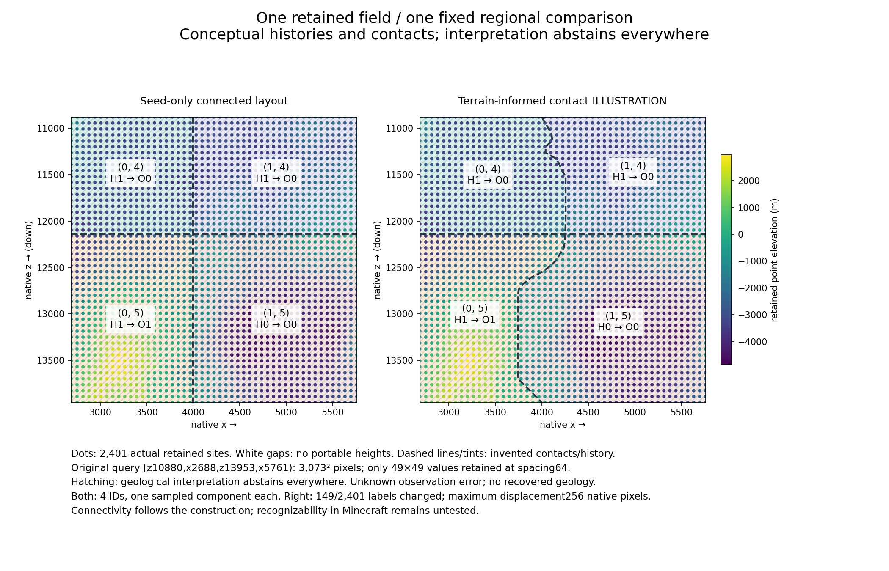

# Connected synthetic regions on one retained landscape (#11)

Diagnostic only. **Four connected sampled regions in both panels; a visible
but limited terrain relation. Proceed only to a bounded diagnostic implementation
prototype, not production geology selection.** Geology-1 is unchanged.

[Standalone offline viewer](evidence/td-region-visual.html) ·
[Frozen design contract](td-region-visual-protocol.md) ·
[Portable inputs, results, source and API evidence](evidence/td-region-visual.zip) ·
[Hash manifest/results](evidence/td-region-visual.json)

## Reconciliation and authority

On 2026-11-07, fetched origin/main and local HEAD matched merged PR57
`4c025b42363208df0ac7523325360e271d820dc6`. GitHub independently confirmed
#57 merged and #9/#11 open. Read AGENTS.md, PR57 report/protocol/evidence and
PR54–56 reports, frozen protocols and portable evidence. PR55's rules are in
its report and archived executable, with no separately named protocol.
The design contract was committed and pushed at **7f4790b before any new
implementation/evaluation**. Exactly one comparison was implemented, with no
parameter search, substitute field, fresh seed or successive replacement design.
Rendering/layout fixes do not alter that contract or the computed comparison.

Reused evidence: PR57's one exact `visual-data.json`, its query metadata/full
patch hash, the failed pressure reduction and PR54–56 source/API evidence and
limitations. Newly computed: row descriptors, illustrative displacements, IDs,
histories and sample-grid topology. Visual judgment below is an author's map
assessment, not a measured player study. No TD execution, new terrain queries,
runtime acceptance or new save-safety evidence occurred. All previously inspected
seeds and analytical controls remain development data.

## Observations and missing support

The sole input is seed8675309, retained candidate row48/col16, chosen already
by PR57's fixed archive order. Its old candidate `ridge` label is retained
provenance, **not** a validated extremum used by this construction.
The original query was half-open native `[z10880,x2688,z13953,x5761]`,
3073×3073 =9,443,329 native pixel values. Only49×49 =2,401 point elevations
are retained, at `(x,z)=(2688+64c,10880+64r)`, r,c=0..48. Thus9,440,928
original queried heights are unavailable here. The last retained site is
(5760,13952); the upper query boundary is one pixel beyond it. Exterior heights
are unknown. A retained full-patch hash cannot recreate its missing array.
There are no missing values at these2401 sites. White gaps have no portable
height values and between-point geometry/error is unresolved.

Verified pinned API using retained provider bytecode plus LocalTerrainProvider
and WorldPipeline source (explanatory upstream8acd2b6; pinned CPU JAR SHA256
`3212b53cc1af656e37fb73511aa64f9623ea38e274705d102ce7cd9944092fe8`).
`getPipelineData(i1,j1,i2,j2,withClimate)` exposes elevation and optional climate;
`getPipelineCoarse` exposes a weighted seven-channel tensor (six signals and
blend weight). WorldPipeline builds elevation/p5/climate conditioning and optional
climate; no geological history/rock/tectonic layer is established by this API.
Only the retained elevations are used. No p5-as-relief, unavailable layer,
transferred geology-1 cutoff, alternate anchor or new native mean is introduced.
The exact API evidence and hashes used are included in the portable archive.

The evidence toggle shows either point elevation or maximum absolute elevation
difference to the four observed neighbors64 native pixels away. This five-point
cross is descriptive only;192 edge sites lack it and are grey. It establishes
no continuous relief, extrema, confidence, likelihood or error bound. Observation
error is null/unknown, never zero. Geological interpretation abstains everywhere
in both panels, including points with complete stencils.

## One connected construction and its finite scope

The frozen protocol specifies all constants and canonical hash strings.
Globally anchored2048-native-pixel cells have seed-derived phases(1951,1902).
Mathematical floor assigns signed integer ID(i,j), with lower boundary ownership
and fixed radius-one3×3 ID neighborhood. SHA256 domain separation supplies a
single history token per ID; surface and deep reference that same record.
H0/H1 inherited substrate and O0/O1 later overprint are abstract invented tags,
not rocks or inferred events. Full tokens distinguish IDs even when tags coincide:
the top two regions both read H1→O0. The diagram does not establish geological
need for a contact between those two abstract histories.

For the sole terrain illustration, each row's centroid uses nonnegative weights
`h-rowMinimum`; it describes where sampled elevation above that row-relative
baseline is concentrated. The fixed half-gain, ±256 clamp and four-row end taper
produce w(z). Linear interpolation connects CONTACT displacements, never heights.
The inverse mapping `(x,z)->(x-w(z),z)` assigns the original lattice IDs. All
vertical contacts share that shear; horizontal contacts stay fixed. Endpoint
displacement is0 and w=0 beyond the retained z range. No threshold accepts an
illustrative contact as a geological decision. Zero-weight rows would descriptively
abstain/use0; no such input failure changes the interpretation abstention policy.

Every whole conceptual region is an invertible image of a connected square.
This proves construction connectivity, not between-sample terrain continuity.
Viewport clipping can in general split a cell, so the exact retained-grid components
are counted independently below. The sheared lattice is an authored extension
even outside observed x support, with no claim of terrain knowledge there.
At most2 rows/98 retained heights support a displacement,5 heights a difference
and9 IDs the declared regional neighborhood. The finite retained model uses two
2401-site arrays and49 row descriptors. Region construction uses no flood fill
or discovery-dependent search. The separate component audit traverses only the
fixed2401-site graph; that bounded audit does not discover or assign regions.
There is no tiling policy for other observation fields, and none is implied.

## Fixed computed result

| Check | Seed-only | Terrain illustration |
| --- | ---: | ---: |
| IDs visible at retained sites |4|4|
| Four-neighbor components for each ID |1 each|1 each|
| Site counts (0,4)/(1,4)/(0,5)/(1,5) |420/560/609/812|476/504/552/869|
| Adjacent pairs with differing IDs |98|116|
| Changed site labels from seed-only |—|149/2401 (6.21%)|
| Maximum horizontal displacement |0|256 native pixels|
| Confirmed geological interpretations |0|0|

Transitions are discrete grid counts, not contact length or a coherence quality
score. The exact rows, centroids, displacements, histories, arrays and provenance
are in `result.json` inside the ZIP. Reversed traversal returns identical IDs;
the same fixed input produces byte-identical result/viewer bytes. These are
offline repeatability results, not cross-provider floating-point guarantees.
Historical matching-support failures remain failed; a Python shear does not
resolve TD numerical sensitivity or establish deterministic runtime observations.

## Player-facing assessment and next decision

In the inspected static rendering, all four domains are easy to distinguish as
large connected map regions. The bent vertical contact shifts right in the upper
part and left in the lower part, in the same broad direction as the observed
high-elevation concentration. That relation is more legible than the straight
seed-only contact. It is limited: the contact does not track a demonstrated
landform, horizontal contacts cut across terrain arbitrarily, the cap creates
nearly straight stretches and the taper returns the contact to its seeded
position for authored boundary reasons. The current top-two event tags coincide.
There is no evidence that every contact is geologically meaningful or that these
abstract histories would be recognizable while walking through Minecraft.

This comparison demonstrates that a finite terrain descriptor can visibly bend
connected seeded domains while retaining shared conceptual surface/deep identity.
Connectivity and repeatability have evidence independent of attractive colors.
It does **not** demonstrate recovered geology, validated extrema, exposure/depth
structure, robust orientation independence, successful multi-field joining,
production selection, gameplay acceptance or publishability. Lattice scale,
history vocabulary, displacement gain/cap/taper and contact interpolation remain
authored. Unknown height error prevents elevating the illustration to an accepted
geological choice. No second design was evaluated to improve this result.

**Shortest justified next step:** one opt-in development-only addon debug overlay
of this exact immutable retained-field comparison, with region/history inspection
and a single conceptual surface-to-deep section. Keep it detached from production
block selection and saves, and verify the shared identity across chunk boundaries,
signed coordinates and traversal order. That bounded implementation would make
the intended terrain-aware regional experience visible inside the addon and
expose scale/readability problems without another survey or numerical experiment.
Do not promote this centroid rule to a geological selector. A later selector
needs its own finite observation/uncertainty and joining contract before adoption.

## Verification and limits

`python scripts/build-td-region-visual.py` strictly checks the immutable PR57
input digest, exports the single fixed result and generates a standalone HTML
with embedded data and no network dependencies. `python scripts/test-td-region-visual.py`
checks portable member hashes/exact replay, repeatability/reverse traversal,
negative coordinates and exact boundary ownership, bounded neighborhoods/support,
shared history, computed/conceptual separation, corrupt-input rejection and
preservation of PR57's failed reduction. `node scripts/test-td-region-viewer.cjs`
executes the generated JavaScript against a DOM stub to check sample/contact
counts, the evidence toggle, inspection and overlay controls. This is not an
actual browser/layout test.

The browser inspection route failed: the in-app browser could not reach the
local preview, and computer-use then stopped because it could not determine the
Windows browser URL confidently enough to enforce its policy. No alternate UI
automation was attempted. **Real-browser layout and click behavior remain
unverified.** The separate static PNG of the same exact result was visually
inspected; it is not a screenshot of the HTML. Its renderer, image digest and
result digest are portable. Matplotlib3.10.7/numpy2.5.4/DejaVu Sans render it;
neither dependency is needed for portable evidence or viewer execution.

`python scripts/reexport-td-region-visual.py runs/acceptance/NAME` chains the
unchanged original-source/artifact #47–#53 exports, PR54 analytical/exact arrays,
PR55–57 evidence and new regional ZIP/JSON/HTML. Final merged Windows checkout
must strictly reproduce all retained and new evidence; PR/CI/final audit status
is recorded on the PR. Offline builds do not establish runtime acceptance.

Pre-PR verification passes Java21 build/domain/settings/coarse/runtimeProbeJar,
resource/catalog checks, all54 Python tests (53 pass, one unchanged frozen skip)
and the offline JavaScript check. The strict original-source/artifact chain
passed in `runs/acceptance/td-region-visual-strict-premerge-01`, preserving old
failures and PR57's failed reduction. After that audit the new builder's Windows
line endings were normalized to its explicit LF checkout rule and the archive
was repackaged; result/viewer bytes did not change. New portable replay checks
pass on the final package. An initial generic unittest discovery command found
zero tests because the historical filenames contain hyphens; each test script
was then executed explicitly. Initial local rendering needed its plotting
dependency and a writable font-cache path; build checks needed access to the
existing Gradle cache. These were tooling retries, not new terrain executions
or replacement comparison designs.

## Every carried-forward gate remains

PR57's single reduced pair fails, with no pressure reduction/numerical experiment
continued. PR51 `Paired coarse drift`, PR52 `Actual matching native support changed`,
original height/residual criteria and #5's stronger final-block assertion remain
failed. PR54's four-launch budget is exhausted; its26 arrays match its direct
baseline/PR52 scale6. PR54 runtime used4a2fa1c; its final capture mixin remains
compile-verified only. Historical full arrays/indices/ULPs remain unavailable;
no historical cause or runtime reproducer is established.

Geometry requires declared finite observation support and uncertainty/abstention;
no unrestricted ridge/basin identity or geological history recovery follows from
terrain shape. Numerical cause/reproducer and separately pushed selector,
evaluation/resource protocols remain gated. Later genuinely fresh validation
requires new seeds, scales1/6, negative coordinates, contrasting terrain and
multiple coarse/province contacts, fixed coverage separate from selected features,
and paired shared cells/scales. Reused development data cannot satisfy those gates.

Any later justified runtime experiment must first commit/push protocol AND executable
collector, fixed launch caps including failures, exact arrays/sequences/counters,
executed sources/artifacts/inputs, startup/request/window/memory/disk/wall caps
and partial-failure retention. This slice prepares/authorizes none.

Adoption still requires immutable versioned generator identity, explicit new-world-only
choice, genuine bidirectional continuing-save rejection, exact original-artifact
restoration/reopen and complete snapshot/block/persisted-container preservation.
Never migrate continuing geology-1. Integrated performance requires alternating
paired CPU startup/cold/warm/full-route benchmarks on NEW fixtures; isolated counts
are not route speedups. Old save/529-container acceptance is reused, not newly run.
Strict guards, immutable shared inputs, optional Ulti-World and unrelated temp/
remain untouched. #9/#11 remain open. No production selector, palettes, dikes,
minerals or integrations were introduced.
