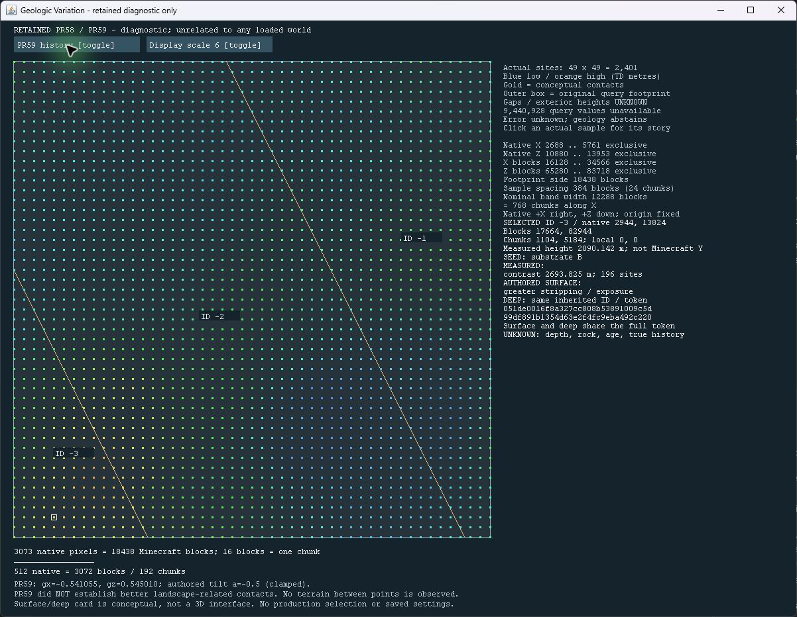

# Retained comparison at Minecraft scale (#11)

Development display only. No production selection or new geological construction.
PR59's negative result remains: terrain-dependent history and connected bands do
**not** establish better landscape-related contacts than PR58.

[Contract](td-retained-map-protocol.md) was pushed at **2078d25** before implementation.
Fetched main/HEAD matched merged PR59 **5d007f5**; GitHub independently confirmed
the merge and its final CI/audit record. Pre-existing viewer-repair files
`docs/td-region-viewer.html`, `scripts/build-td-region-preview.py` and unrelated
`temp/` were preserved. Read PR54–59 reports, contracts and retained evidence.

## Display and isolation

The probe-only `RetainedMapScreen` toggles unchanged PR58 terrain-illustration
records against PR59's single story. It shows all 2,401 actual sample sites,
original query footprint, exact conceptual contact polylines, stable IDs and
missing between-point/exterior support. Click within six logical pixels of an
actual site to inspect it; a gap click clears the card. The card separates seed
choices, measured descriptors, authored surface interpretation, deep inherited
identity and uncertainty. Full shared tokens are visible on two lines.

No height interpolation, substitute terrain, Minecraft Y, current-world claim,
world access, saved setting or generation hook exists. Sources and resource are
in `runtimeProbe`, excluded from the production addon JAR. A probe-only title
button requires `-Dgeology.probe.retainedMap=true`. Escape returns to its parent.
This is tooling for this one fixture, not a production option or general map system.

No Minecraft client was launched. A normal pinned client can initialize TD;
this slice has no proven no-inference client route, so normal startup was avoided.
Instead, the same retained model and drawing commands run in an isolated JDK
Swing window with only probe output/resources on the classpath, no Minecraft/TD
classes. **Actual isolated desktop behavior is verified; the Minecraft Screen,
title mixin, font scaling and Escape route are compile-verified only.**

After `gradlew.bat runtimeProbeJar`, the safe isolated route is:

```powershell
& 'C:/Program Files/Java/jdk-21/bin/java.exe' -Xmx128m -cp 'build/classes/java/runtimeProbe;build/resources/runtimeProbe' dev.wilyjeb.geology.probe.RetainedMap
```

Do not use `runClient` for this diagnostic. No TD execution is authorized.

## Distances and immutable evidence

Native X/Z are preserved exactly, positive X right and positive Z down, absolute
origin unchanged. `X=s*x,Z=s*z`; display scale is 1 or 6, independently of worlds.
The half-open query is X[2688,5761), Z[10880,13953); the last sites are 5760,13952.
At scale1/6, footprint side is 3,073/18,438 blocks, sample spacing 64/384 blocks
(4/24 chunks), nominal 2,048-native band width 2,048/12,288 blocks (128/768 chunks
along X). Slanted-band perpendicular width differs; the label explicitly says
along X. Signed block ownership floors; chunk=floor(block/16), local=floorMod16.
Elevation remains measured TD metres. Scale does not turn gaps into observations.

[Portable ZIP](evidence/td-retained-map.zip) includes the exact PR59 archive,
copied records, display sources/contract, screenshots and verification record;
[manifest](evidence/td-retained-map.json) hashes every member. The input/result
hashes are frozen in the contract. Java rejects a changed resource SHA256;
the exporter verifies original archive and all three input/result member hashes.
No PR54–59 frozen input, result, archive, viewer or rendering is replaced.

Fixed bounds: 2,401 sites, seven cards, 298 contact segments; resource cap2MiB,
isolated heap128MiB, fixed viewport and bounded hit-test/drawing loops. No growing
cache, background worker, network or inspection-time disk writes. Four headless
PNGs are separate Java renders, not Minecraft or desktop screenshots.

## What was actually seen and checked

The actual desktop was inspected at scales1/6. Verified scale toggle, exposure
site selection at native2944,13824, baseline/story toggle preserving that sample,
full shared-token cards and gap deselection. Screenshots retain these outcomes:

The exact desktop-executed Java source is retained and hashed separately. Final
source adds only the immutable resource SHA guard and coordinate cap assertions;
those additions pass compile/Java checks and do not change drawing or controls.



[PR58 same sample/scale](evidence/td-retained-map-desktop-pr58.png) ·
[Gap remains unknown](evidence/td-retained-map-desktop-unknown.png) ·
[Verification record](evidence/td-retained-map-verification.json)

Four new Python tests check exact portable replay, immutable inputs, contact
agreement on both sides/ties, every retained ID in forward/reverse traversal,
shared surface/deep tokens, signed coordinates/chunk edges and scales1/6.
`testRetainedMap` additionally exercises the actual Java conversion, cap guards,
clipping, toggles and sample/gap hit testing without loading Minecraft or TD.
Existing identity/connectivity checks are rerun on retained records; they are
not new terrain observations. All63 Python tests completed (62 pass, unchanged
frozen skip1); both offline JS checks pass. Java21 build/probe, domain/settings/
coarse/map checks, masonry and catalog checks pass. An initial unittest-discovery
command discovered zero tests; the explicit per-file suite then ran all63.

Strict original-source/artifact retained chain through PR59 passed in
`runs/acceptance/td-retained-map-strict-premerge-02`; attempt01 was denied junction
creation and retained. New map strict export also passes. Final CI, merge and
strict retained/new re-export after final Windows checkout are recorded on the PR.
This is offline evidence packaging and compile verification, not runtime acceptance.

## Judgment and smallest next step

**Qualified yes for understanding the diagnostic:** the map makes the scale of
the three regions, the four-cell baseline, contacts and surface/deep reference
legible. Selecting the small high band makes its contrast/exposure relationship
explicit; the covered bands visibly share an event while retaining distinct deep
identities. Scale6's 768-chunk nominal width is a substantial travel distance.
This is visual judgment from the actual isolated display, not player recognition.

The comparison also makes the weakness plain: straight PR59 contacts cut across
curving elevation patterns; PR58's bent contact is locally more recognizable,
but its horizontal seam remains. Displaying those records adds no evidence for
better contacts, geological plausibility or block-level experience.

The smallest remaining step toward a visible addon prototype is to verify this
exact probe Screen in an **isolated no-TD diagnostic client configuration**,
including title entry, GUI scaling, selection and return. That configuration
has not been implemented or authorized here. No new regional construction is
needed to answer that display question. In-world/player recognition and any
production candidate require separate scope and validation; this map cannot
establish them. Do not promote the straight-band rule.

## Carried-forward gates

All PR54–59 validation/performance/adoption/save-safety gates remain. Failed PR57
reduction, PR51 `Paired coarse drift`, PR52 `Actual matching native support changed`,
height/residual criteria and #5's stronger final-block assertion stay failed.
Geometry/uncertainty, historical numerical cause/reproducer and multi-field joins
remain unresolved. PR54 exhausted four launches, ran4a2fa1c; final capture mixin
is compile-verified only. Historical arrays/indices/ULPs remain unavailable.

Later fresh validation requires a pushed finite-support/uncertainty/selector/
evaluation/resource contract, new seeds, scales1/6, signed coordinates, contrasting
terrain, multiple contacts, fixed coverage separate from selected features and
paired shared cells/scales. Any justified runtime experiment needs pushed protocol
AND executable collector, caps including failed launches, startup/request/window/
memory/disk/wall limits and complete arrays/sequences/counters/sources/artifacts/
inputs/partial failures. None is authorized here. Performance requires alternating
paired CPU startup/cold/warm/full-route work on NEW fixtures; no speedup is claimed.

Adoption needs immutable versioned identity, explicit new-world-only choice,
bidirectional continuing-save rejection, exact original-artifact restore/reopen
and full snapshot/block/persisted-container preservation. Old529-container/save
evidence is reused, not rerun. Geology-1, production selection, continuing worlds,
strict guards, immutable inputs, optional Ulti-World remain unchanged. No palettes,
dikes, minerals, integrations or save migration. **#9/#11 remain open.**
