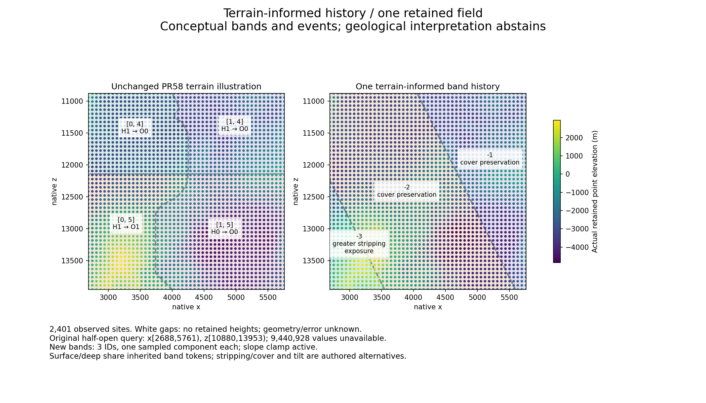

# Terrain informs one synthetic regional history (#11)

Diagnostic only. **Terrain changes the authored history, but this slice does not
establish better landscape-related contacts than PR58.** Three connected bands
replace the four-cell boundary illustration. Geology-1 is unchanged.

[Offline viewer](evidence/td-story.html) · [Frozen contract](td-story-protocol.md) ·
[Portable evidence](evidence/td-story.zip) · [Hashes/results](evidence/td-story.json)

## Authority and one evaluation

Fetched main and local HEAD both matched merged PR58 `8aa21cc30c782523ca7b3eda055a9308a4bb0944`.
GitHub independently confirmed PR58 merged and #9/#11 open. Read AGENTS.md,
PR54–58 reports/protocols and retained portable evidence. The small story-1
contract was committed and pushed at **f38e639 before implementing/evaluating**.
Exactly one construction and one comparison were evaluated. No TD execution,
new queries, fresh seeds, alternate fields, search, pressure reduction or
numerical experimentation. Presentation fixes did not replace the construction.

Local untracked `docs/td-region-viewer.html` and
`scripts/build-td-region-preview.py` predated this work and are preserved separately,
as is unrelated temp/. No PR58 frozen archive, result, viewer, image or source
was repaired or replaced. The left panel copies PR58's terrain illustration,
not its seed-only control: identical IDs, histories and contact geometry.

## Evidence and four distinct meanings

The sole terrain input is the exact PR57/58 retained visual-data.json, SHA256
`8dc1e0a9f98edd1dc6b2ce74cc1d795c117c15feb9503b0260a5c5ef23a701d6`.
Seed8675309, original half-open native query [z10880,x2688,z13953,x5761].
Only 49x49 elevations at spacing64 remain: 2401 of9443329 original values;
9440928 values unavailable. Exterior support and between-point geometry/error
are unknown. No missing retained point is filled. Old candidate labels are
provenance, never confirmed extrema. Edge five-point stencils are incomplete at
192 sites; this new whole-field summary does not consume those stencils.

Re-inspected portable pinned-provider bytecode and LocalTerrainProvider/
WorldPipeline source: getPipelineData exposes elevation and optional climate;
getPipelineCoarse exposes conditioning signals/weight. WorldPipeline explicitly
constructs p5 and climate conditioning, not geology/tectonic/history layers.
Pinned CPU JAR SHA2563212b53cc1af656e37fb73511aa64f9623ea38e274705d102ce7cd9944092fe8;
source8acd2b6 is explanatory. API evidence is copied into the ZIP. Only retained
elevations are used; no p5-as-relief, invented observation layer or zero error.

* Stable identity: global signed integer band IDs and seed-derived tokens/anchors.
  Phase667, anchors (667+2048*(i+1/2),0), independent of observations. ID membership
  responds to history orientation, but the identity token does not change.
* Descriptive evidence: whole-field planar regression slopes and per-band observed
  mean elevation contrast. These are descriptions of the retained sites only.
* Authored interpretation: inherited layers, conceptual tilting responding to the
  broad trend, then greater stripping or cover preservation responding to contrast.
  Seed parity selects substrate A/B. Scale, clamp and geological vocabulary are
  authored. Positive elevation contrast is not evidence that erosion happened.
* Uncertainty: geological interpretation abstains everywhere. No observed dip,
  rock, cover thickness, depth, formation environment, age or erosion rate follows.

## One construction, shared surface/deep meaning

Let a=clamp(gz/gx,-0.5,0.5). Signed ID is floor((x+a*z-667)/2048),
with mathematical floor, lower-boundary ownership and exact ties assigned to the
higher ID. Contacts x=667+2048*i-a*z are shared edges of inherited bands.
This single tilted-layer construction has no independent horizontal seam or
decorative noise. Whole bands and rectangular viewport intersections are convex,
so connected; discrete sample topology is independently audited.

The history has an explicit observation dependency: regression influences the
authored tilt relationship, which determines band domains/contacts; observed
band contrasts then determine exposure versus preserved-cover relationships.
It is not a previously fixed random event sequence with only boundary bending.
However, only the tilt affects domain geometry; the later stripping event changes
the conceptual surface relationship without inventing another boundary or depth.
Surface and deep share the exact inherited ID/token, with surface exposure/cover
over the same deep substrate. This is a conceptual relationship, not a computed
3D geological interface or an independent deep RNG.

Maximum support is this fixed2401-point rectangle and the three IDs i-1,i,i+1.
There is no flood-fill region discovery. A bounded2401-node audit counts sample
components. All inputs are fixed before traversal. The global coordinate formula
outside the field is conceptual extension with unresolved event support, not
knowledge of exterior terrain. No joining policy for multiple fields exists.

## Fixed result

gx=-0.5410553201034904, gz=0.5450102547687877 metres/native pixel.
Their ratio is -1.007309667825724, so **a=-0.5 and the authored clamp is active**.
The mean observed elevation is -2167.4827969884423m. This is sample mean,
not a new native mean or a geological reference level.

| New ID | Sites | Components | Contrast to field mean (m) | Authored event |
| --- | ---: | ---: | ---: | --- |
| -3 |196|1|+2693.825260|Greater stripping / exposure|
| -2 |1458|1|-220.981686|Cover preservation|
| -1 |747|1|-275.499937|Cover preservation|

PR58 retains four IDs, one component each, counts476/504/552/869 and116
adjacent-ID transitions. The new bands have114 transitions. Different ID systems
make a changed-label fraction meaningless; transition counts are neither contact
length nor a coherence score. Neighboring -2/-1 share the same cover event;
their inherited identities/substrates differ, but this does not establish that
the landscape requires their contact.

## Visual judgment and decision

The inspected static rendering makes the small lower-left high-elevation band
and its exposure story easy to distinguish. The two lower-mean bands receive
cover preservation. Terrain therefore participates in the story rather than
only its display. The band contacts are connected and there is no horizontal
seam. These are positive construction results, not recovered geology.

**The stronger comparison question is negative/inconclusive:** straight oblique
bands cut through the curving low/high-elevation pattern. They lose PR58's locally
bent recognizable contact. The active clamp makes angle partly an authored cap;
band scale/phase determine the small triangular viewport region. A single planar
trend compresses away the landscape's curved structure. Current elevation alone
does not justify stripping or cover, and both low-mean bands receive the same
event. Removing a flat seam and adding event labels is not evidence of more
meaningful geological contact coherence. No replacement construction was tried.

The field establishes deterministic finite-input interpretation, connected
conceptual domains, repeatable sample ownership and shared surface/deep history
references. It cannot establish orientation robustness, multi-field joins,
terrain uncertainty bounds, geological plausibility, runtime TD determinism,
chunk-scale visibility, player recognition, performance or publishability.
This one already-inspected field is development evidence, not fresh validation.

**Shortest justified next implementation:** an opt-in development-only addon
overlay that displays these exact immutable baseline/new records, sample support
and inspectable shared history at world scale, with a conceptual surface/deep
inspection card. That makes the terrain/history relationship visible to a player
without adopting this weak straight-band rule for block selection. Implement only
the diagnostic display and verify coordinate conversion/chunk-edge identity on
the retained fixture; do not build another simulator or promote the band story.
A useful production candidate still needs a separately frozen finite observation,
uncertainty and multi-region joining contract plus the gates below.

## Verification and presentation limits

Five new Python tests cover exact portable replay/member hashes, repeatability,
reverse/shuffled traversal, actual sample components, signed IDs/ties, finite
bounds, shared contact ownership, exact supported history contrasts/tokens,
corrupt-input/baseline rejection and script-free SVG presence. Optional JavaScript
overlay controls are exercised with a DOM stub, not a real browser. Both maps
(4802 total sample circles), IDs, history table and results are embedded in HTML
before the script; disabling JavaScript leaves them visible. Point titles expose
actual sample coordinates, elevation, conceptual ID and unknown error.

Actual HTML source was inspected and structurally checked. Browser policy rejected
the file URL, so **browser layout/click behavior remains unverified**; no alternate
browser route was used. The PNG is a separately inspected matplotlib rendering
of the exact result, not a screenshot. Existing local runs/offline-plot-libs were
used, with image/result/renderer hashes and versions packaged. An attempted pip
installation was rejected by automatic review under the offline-only constraint;
nothing was downloaded or installed. No plotting libraries are needed for
portable verification or viewer operation.

All59 Python tests completed (58 passed, one unchanged frozen skip), and both
offline JavaScript checks passed. Production-source diff against PR58 is empty.
The strict original-source/artifact retained chain plus final packaged story
export passed in runs/acceptance/td-story-strict-premerge-03; the earlier package
also passed in -02. Attempt01 was denied junction creation
before completing; it is retained. Final package must reproduce again after the
merged Windows checkout, using scripts/reexport-td-story.py. Final CI/merge/audit
outcomes are recorded in the PR. Newly performed offline checks are distinct from
reused runtime/save evidence; no runtime acceptance is claimed.

## Unchanged gates

All PR54–58 gates remain. PR57 reduction, PR51 Paired coarse drift, PR52 Actual
matching native support changed, original height/residual criteria and #5's
stronger final-block assertion remain failed. Geometry/uncertainty and numerical
cause/reproducer remain unresolved. PR54's four launches are exhausted; it ran
4a2fa1c, and its final capture mixin is compile-verified only. Historical full
arrays/indices/ULPs are unavailable.

Fresh validation still requires new seeds, scales1/6, signed coordinates,
contrasting terrain, multiple contacts, fixed coverage separate from selected
features, and paired shared cells/scales. Any later justified runtime experiment
needs pushed protocol AND executable collector, failures consuming launch caps,
request/startup/window/memory/disk/wall limits, complete arrays/sequences/counters,
executed sources/artifacts/inputs and partial failures. None is authorized here.

Performance needs alternating paired CPU startup/cold/warm/full-route measurements
on NEW fixtures; topology/counts are not speedups. Adoption needs immutable
versioned identity, explicit new-world-only selection, bidirectional continuing-save
rejection, exact original-artifact restore/reopen and complete snapshot/block/
persisted-container preservation. Old529-container/save evidence is reused, not
rerun. Never migrate geology-1. Strict guards, immutable inputs, optional Ulti-World,
production and unrelated temp/ remain untouched. No palettes/dikes/minerals/
integrations or production selector. #9/#11 remain open.
