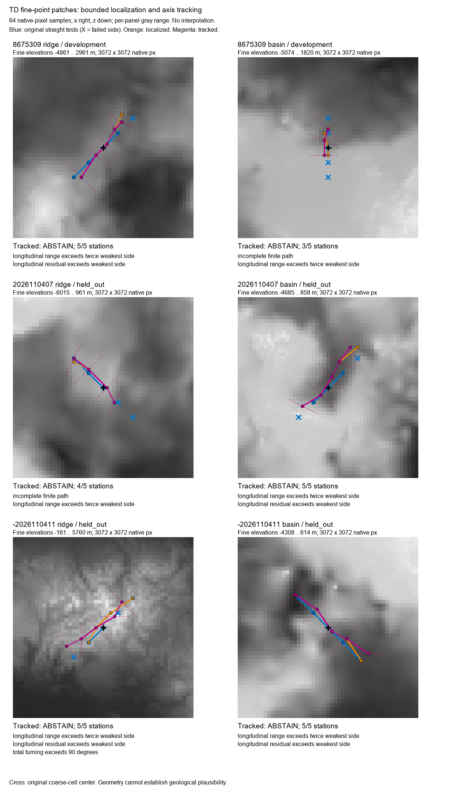

# Bounded TD center and orientation diagnostic (#11)

**Diagnostic only: retain actual-target point diagnostics. Geological selection abstains; geology-1 is unchanged.**

4/6 native candidate attempts contain five qualifying two-sided fine-point stations after tracking; 0/6 pass all frozen point-path criteria. Partial recovery is not complete continuity. Failed finite greedy searches do not establish genuine physical interruption.

[Portable evidence](evidence/td-tracking-negative.json), [frozen protocol](td-tracking-protocol.md), and [excluded development attempts](evidence/td-tracking-attempts.json).

Main and GitHub were reconciled at e3fdbcf, with merged PRs #47–#51. The selector/evaluator/resource rules were pushed at ecad7da; the transcript-only probe correction was pushed at 2a52336 before either fresh seed was inspected. All previously examined seeds, including 2026110317 and -2026110319, are development data. There was no held-out retuning.

New accepted collection uses six serial NEW CPU fixtures: development 8675309 and fresh held-out 2026110407 / -2026110411, each at scales 1/6. Repeated scales and shared native cells are paired observations. Fixed coverage is a diagonal transect, separate from selected features and terrain contrasts; no population-accuracy claim follows.

## Fixed coverage and contrasting terrain

| Seed / role | Screen ocean / coast / land | Selected strata present |
| --- | --- | --- |
| 8675309 / development | 32 / 28 / 21 | ocean, coast, lowland, intermediate, mountain |
| 2026110407 / held_out | 36 / 18 / 27 | ocean, coast, lowland, intermediate, mountain |
| -2026110411 / held_out | 36 / 19 / 26 | ocean, coast, lowland, intermediate, mountain |

Ocean/coast/land are signs of nine coarse averages relative to zero, not geological labels or validated fine shoreline exposure. Low/intermediate/high land are selected contrasts, not independent coverage samples. The five fixed coverage points and all twelve boundary points retain their own memberships when locations overlap selected features.

## Geometry and uncertainty

The local search uses the top original two-sided coarse candidate per kind. The original strict five-station coarse evaluation remains unchanged. Fine patches contain actual floating TD elevations at 64-native-pixel spacing; they do not substitute analytical terrain. Straight, localized fixed-axis, and turning paths are evaluated separately. All require 50 m on both sides and the original longitudinal range/residual bounds. Full alternatives, reasons, stations and shoulders are portable.

| Seed / role | Kind | Strict coarse | Fine straight / localized / tracked | Tracked stations | Center shift (native px) | Axis turn (degrees) | Weakest side (m) |
| --- | --- | --- | --- | ---: | ---: | ---: | ---: |
| 8675309 / development | ridge | **fail** | **fail** / **fail** / **fail** | 5 | 90.51 | 55.30 | 216.51 |
| 8675309 / development | basin | **fail** | **fail** / **fail** / **fail** | 3 | 143.11 | 45.00 | 333.34 |
| 2026110407 / held_out | ridge | **fail** | **fail** / **fail** / **fail** | 4 | 64.00 | 36.87 | 128.89 |
| 2026110407 / held_out | basin | **fail** | **fail** / **fail** / **fail** | 5 | 202.39 | 73.74 | 211.39 |
| -2026110411 / held_out | ridge | **fail** | **fail** / **fail** / **fail** | 5 | 128.00 | 180.00 | 73.53 |
| -2026110411 / held_out | basin | **fail** | **fail** / **fail** / **fail** | 5 | 90.51 | 45.00 | 300.80 |

Every original fine-point station is retained in the [full-station audit](evidence/td-tracking-profiles.json), including tails where greedy tracking stopped. This uses the frozen 50 m/range/residual arithmetic for description; it does not replace the frozen coverage gate.

| Seed / kind | Original / localized / tracked two-sided stations | Original fine-point weakest side (m) | Original strict fine-point result |
| --- | --- | ---: | --- |
| 8675309 / ridge | 4 / 5 / 5 | -778.93 | **fail** |
| 8675309 / basin | 1 / 3 / 3 | -319.49 | **fail** |
| 2026110407 / ridge | 3 / 3 / 4 | -737.32 | **fail** |
| 2026110407 / basin | 3 / 4 / 5 | -1221.14 | **fail** |
| -2026110411 / ridge | 3 / 4 / 5 | -1074.96 | **fail** |
| -2026110411 / basin | 5 / 5 / 5 | 141.67 | **fail** |

Recentring restores all five two-sided stations in 1 attempt(s); allowing orientation changes adds five-station recovery in 2 more. 1 original fine-point profile(s) already have two-sided extrema at all five stations and fail the longitudinal height conditions instead. Attempted paths exceeding the combined 90-degree turn limit stay failed; the limit is checked after both bounded branches are assembled.


Recovery of five two-sided stations can demonstrate a localization/orientation contribution while the complete longitudinal rule remains failed. Missing bounded stations leave genuine interruption, off-center alternatives and limited orientation/curvature tracking unresolved.

Failure reasons and ablation interpretations (native observations only):

- 8675309 ridge: unresolved interruption or ambiguity at bounded resolution; longitudinal range exceeds twice weakest side; longitudinal residual exceeds weakest side.
- 8675309 basin: unresolved interruption or ambiguity at bounded resolution; incomplete finite path; longitudinal range exceeds twice weakest side.
- 2026110407 ridge: unresolved interruption or ambiguity at bounded resolution; incomplete finite path; longitudinal range exceeds twice weakest side.
- 2026110407 basin: unresolved interruption or ambiguity at bounded resolution; longitudinal range exceeds twice weakest side; longitudinal residual exceeds weakest side.
- -2026110411 ridge: unresolved interruption or ambiguity at bounded resolution; longitudinal range exceeds twice weakest side; longitudinal residual exceeds weakest side; total turning exceeds 90 degrees.
- -2026110411 basin: unresolved interruption or ambiguity at bounded resolution; longitudinal range exceeds twice weakest side; longitudinal residual exceeds weakest side.

The localized ablation keeps a fixed shoulder axis but may recenter at each station: it cannot uniquely distinguish a translated straight ridge from a gently curving centerline that retains that axis. Axis-turn limits constrain discrete sampled orientations, not a reconstructed continuous tangent field. Axis choices also change shoulder/step length from 256 to 362 pixels; this is not a controlled constant-bandwidth rotation experiment. The residual is linear in station index, preserving the original arithmetic rather than fitting an arc-length detrend. Greedy tracking never backtracks through a second branch. Failure of all ablations is not proof of genuine interruption. Unresolved center/orientation alternatives, finite search limits and between-grid extrema remain competing explanations.

Localization quantization is +/-32 native pixels per axis (45.26 radial); this is not a confidence interval. Additional between-grid and competing-center uncertainty remains. Initial displacement is bounded at 256 pixels; later searches are radius128 and constrained within256 of each original straight station. Edge winners abstain. Comparable alternatives within50 m and >128 pixels transversely or >45 degrees apart abstain as branches/intersections. Missing paths, slopes, saddles, excess range/residual or turning remain failures. Fine point support does not establish a geological origin.

Analytical controls are separate: diagonal ridges/basins pass; slopes, saddles, flat fields, edge winners and competing parallel centers abstain. A perfect cardinal ridge can also abstain because unequal discrete axis lengths tie on transverse prominence and trigger orientation ambiguity. This conservative false negative is preserved, not tuned away on examined terrain. Neither analytic success nor this selector limitation establishes actual TD feature coverage.



## Matched means and scaled fine tiles

| Seed | Kind | Native-cell mean continuity | Tile scale1 / scale6 continuity | Native weakest side / range / residual (m) |
| --- | --- | --- | --- | --- |
| 8675309 | ridge | **fail** | **fail** / **fail** | -232.58 / 1123.97 / 510.22 |
| 8675309 | basin | **fail** | **fail** / **fail** | -5.54 / 2321.68 / incomplete |
| 2026110407 | ridge | **fail** | **fail** / **fail** | -875.90 / 2117.23 / incomplete |
| 2026110407 | basin | **fail** | **fail** / **fail** | 190.90 / 2402.12 / 1432.03 |
| -2026110411 | ridge | **fail** | **fail** / **fail** | -710.99 / 1470.23 / 1412.86 |
| -2026110411 | basin | **fail** | **fail** / **fail** | 75.69 / 1940.67 / 1787.49 |

Frozen new coverage gate: **FAIL**. It requires a ridge AND basin on BOTH fresh seeds, with unambiguous tracked points, native-cell means and scaled tiles at BOTH scales. This is a separate descriptive gate; no output-changing policy is adopted.

Full native-cell means summarize 65,536 floating elevations. Coarse 3x3 neighborhood range is a different support statistic. Scaled 256-world-block tiles retain 25 quantized sample heights; at scale 6 their native footprint is smaller. Fine-cell relief and fine-tile relief remain separate from all means and from coarse range. No p5 or geology-1 cutoff is transferred.

Supplementary same-coordinate check: 153/154 quantized patch/tile origin-corner records agree, over 89 distinct seed/native corners. These repeated records are correlated. Seed 2026110407 at [16640, 3072]: patch -1605.0055 m quantizes to -1606, tile corner is -1605. Discrepancies remain visible, without a tolerance or a causal claim. This descriptive coordinate/product audit does not replace any frozen acceptance criterion.

## Terrain agreement and boundaries

Mean absolute central coarse versus matched-target fine-cell error, in metres; each policy remains compared with the actual target. Scales6 are excluded from these native support counts. Selected features and overlapping strata are correlated.

| Seed / group | Rows | Province anchor | Actual target | Fixed grid4 |
| --- | ---: | ---: | ---: | ---: |
| 8675309 / coverage | 5 | 1126.48 | 114.84 | 1434.75 |
| 8675309 / contrasts | 5 | 677.62 | 52.18 | 638.54 |
| 8675309 / features | 23 | 1364.51 | 112.91 | 1104.62 |
| 2026110407 / coverage | 5 | 1662.79 | 65.31 | 501.36 |
| 2026110407 / contrasts | 5 | 1663.16 | 49.42 | 731.72 |
| 2026110407 / features | 27 | 1621.27 | 127.10 | 945.86 |
| -2026110411 / coverage | 5 | 1557.01 | 75.66 | 1062.55 |
| -2026110411 / contrasts | 5 | 1793.92 | 92.58 | 905.82 |
| -2026110411 / features | 30 | 1444.66 | 98.79 | 733.99 |

| Seed / scale | Coarse/grid contacts / province contacts | Max anchor / target / grid coarse jump (m) | Max tile jump (m) |
| --- | --- | --- | ---: |
| 8675309 / 1 | 4 / 2 | 4809.69 / 604.87 / 3216.76 | 625.88 |
| 8675309 / 6 | 4 / 2 | 4809.69 / 604.87 / 3216.76 | 161.16 |
| 2026110407 / 1 | 4 / 2 | 2516.98 / 692.75 / 1026.25 | 653.40 |
| 2026110407 / 6 | 4 / 2 | 2516.98 / 692.75 / 1026.25 | 118.56 |
| -2026110411 / 1 | 4 / 2 | 3368.04 / 266.43 / 670.85 | 139.80 |
| -2026110411 / 6 | 4 / 2 | 3368.04 / 266.43 / 670.85 | 22.08 |

Boundary jumps describe changed statistical support, not one-block physical cliffs. Province contacts are independently located and required to change the Java-reported province. Actual-target support is distinguished from province-anchor support in every paired comparison:

- Seed 8675309: province_anchor: 33/33 hashes on matching support, 0 differing supports; target: 33/33 hashes on matching support, 0 differing supports; fixed_grid_4: 33/33 hashes on matching support, 0 differing supports; full native patch hashes match: True.
- Seed 2026110407: province_anchor: 37/37 hashes on matching support, 0 differing supports; target: 37/37 hashes on matching support, 0 differing supports; fixed_grid_4: 37/37 hashes on matching support, 0 differing supports; full native patch hashes match: True.
- Seed -2026110411: province_anchor: 38/40 hashes on matching support, 0 differing supports; target: 40/40 hashes on matching support, 0 differing supports; fixed_grid_4: 39/40 hashes on matching support, 0 differing supports; full native patch hashes match: True.

Separate [cross-run PR51 point audit](evidence/td-tracking-retained.json): 44 repeated world-location rows, 128/132 exact full native-policy objects; coarse objects equal at 132/132. Maximum native-mean difference 4.41819429398e-06 m; maximum relief difference 0.000106811523438 m. These numeric differences remain strict mismatches despite their small magnitude. Their cause was not isolated. They are separate from within-fixture exact traversal and cannot repair #5's stronger failed assertion.


## Requests, traversal and cache limits

| Seed / scale | Unique comparisons | Deduplicated coarse / native misses forward | Forward / reverse new windows | All post-startup C/D/H/W | Native LRU peak |
| --- | ---: | --- | --- | --- | ---: |
| 8675309 / 1 | 45 | 82 / 82 | 2058 / 376 | 407/348/0/4780 | 82 |
| 8675309 / 6 | 45 | 82 / 82 | 2046 / 369 | 407/168/180/4779 | 82 |
| 2026110407 / 1 | 49 | 90 / 90 | 2261 / 398 | 423/380/0/4929 | 90 |
| 2026110407 / 6 | 49 | 90 / 90 | 2257 / 405 | 423/184/196/4932 | 90 |
| -2026110411 / 1 | 52 | 90 / 90 | 2115 / 417 | 423/392/0/4760 | 90 |
| -2026110411 / 6 | 52 | 88 / 88 | 2074 / 396 | 419/180/208/4698 | 88 |

292 forward world-location comparisons and the same number reversed cover 136 distinct seed/native target cells. Twelve forward patch grids represent 6 distinct seed/native patches; reverse recomputation is additional paired work, not new coverage. The fixed screen has486 rows, representing243 seed/native cells.

C/D/H/W means public coarse / direct-data / heightmap calls / newly computed windows. Each fixture makes four direct patch-data misses, serving196 row commands through a one-entry patch cache; none of those row hits imply new model requests. Fine comparison misses are independently replayed against cleared128-entry coarse/native LRUs forward and reverse. Two uncached tile reads occur per comparison. Window counts for patches, screen and suites are retained jointly in post-startup totals; they are not isolated patch/policy timings. Startup counters remain separate in JSON.

Within every fixture, forward/reverse comparison evidence and reversed patch values/full hashes match exactly after explicit cache clear. Provider tensors can remain warm; this is traversal evidence, not fresh-process final-block determinism. The real coarse suite passes four concurrent callers producing one public request, 129 misses retaining 128 entries and recomputing eviction. Native-cache eviction is not claimed merely because its cap is 128. The patch cache retains one 49x49 float grid; the full 3073x3073 height plane is transient. Internal provider-cache occupancy and native-memory peaks were not measured. The accepted matrix stays within 52 forward/reverse comparisons, 12,000 post-startup windows, 6 GiB heap, 360s startup, 300s command, 45min fixture, 4h matrix and disk reserve guards.

## Preserved failures, scope and remaining gate

PR51’s frozen strict exporter is unchanged and still rejects its retained matrix with **Paired coarse drift**. Its morphology coverage gate remains **failed**. The separate negative exporter first requires that original rejection, then repeats strict source/artifact/transcript checks. This slice neither weakens those assertions nor changes geology-1 to make displaced province anchors correspond.

**Additional frozen assertion: FAIL — Actual matching native support changed.** The new original strict exporter also remains unchanged and rejects this matrix. At seed -2026110411, province-anchor rows at native targets (-320,-4032) and (-64,-3648) share one cell whose fine hash differs across scales; a fixed-grid row at (1088,-3520) differs in a second cell. Support coordinates and coarse evidence match. Mean differences are 7.748603820800781e-7 and 7.003545761108398e-7 m; these are failed exact comparisons, not accepted equivalence. Actual-target native hashes match at all 110 paired rows. This differs from PR51’s displaced-anchor failure: these two cells have matching support but different fine hashes, and their cause was not isolated.

The separately named export-negative-td-tracking.py first executes and requires that exact original rejection, then repeats all source/artifact/raw transcript, selection, traversal, resource and counter checks. Only the three recorded same-support mismatches are retained as failures; all other rejections remain fatal. It corrects descriptive hash-match counts after the frozen hard assertion, records the failed flag and full numeric objects, uses no tolerance, and cannot turn either strict comparison or morphology coverage into a pass. CI explicitly requires the frozen rejection and complete negative replay. The original positive portable-test path is intentionally absent; the separate negative test covers the full matrix.

New work: frozen selector/analytical controls, six CPU sampling fixtures, fine point patches and profiles, exact reverse recomputation, coarse concurrency/eviction/oracles, per-fixture snapshot-byte checks, model/template unchanged checks, source/artifact/log export and request accounting. The production addon is byte-identical to main; every prior probe entry is unchanged and only TrackingPatch.class is added. CI runs build/resource/domain/semantic/portable replay checks; inference runs locally.

Reused work: #47 coarse prototype/original-artifact restoration and save/reopen guards; #48/#49 terrain diagnostics/source-byte portability; #50 actual-target/native-cell support and save/reopen evidence; #51 failed strict profiles and cross-scale anchor evidence. Their original strict exports reproduce committed JSON. Their complete sampled blocks and529 persisted-container/reopen checks are retained acceptance, not newly executed by this sampling-only slice. #5’s stronger failed final-block assertion remains failed; historical route timing is separate.

Excluded attempts: -01 failed a sandbox hardlink before launch; -02 exposed omitted patch transcript logging on development data and was manually stopped (hung shutdown required termination); -03 hit the frozen disk guard and shut down normally. This totals eight JVM launches: six complete accepted fixtures and two excluded development launches; -01 launched none. No fresh seed was inspected in the excluded attempts. Only stopped new-fixture ONNX caches were removed. The user freed disk space before the unchanged accepted -04 restart. Excluded attempts have no complete new-window counter endpoint, so model-return log rows are not substituted for new-window counts or included in the accepted matrix totals.

Remaining gate: first resolve the demonstrated discrete-axis/support-length aliasing with a preregistered constant-bandwidth orientation/localization control and bounded alternative-path/gap tests. Then demonstrate unambiguous independently localized actual TD ridges AND basins, finite two-sided continuity and matched-native/scaled-tile support at scales 1/6 on at least two NEW held-out seeds. Keep this original strict exporter and its failed rules separate. The now-examined seeds become development data for any revision. A finer/wider search or looser continuity rule is not silently substituted here. Independent geological plausibility, history and contact-coherence/calibration remain separate even if morphology succeeds. Retained synthetic-prior-1 competing interpretations remain seeded synthetic hypotheses with uncertainty and abstention, never recovered geological history.

No palettes, dikes, minerals or integrations. Ulti-World stays optional. #9/#11 stay open. Any future output adoption still needs immutable generator identity, explicit new-world-only selection, genuine bidirectional continuing-save rejection, exact original-artifact restoration/reopen and complete snapshot/block/persisted-container preservation. Never migrate continuing geology-1 snapshots. Integrated candidates additionally need alternating paired CPU startup/cold/warm/full-route benchmarks on NEW fixtures. Isolated-query savings are not route savings.

Local verification: JDK 21 build/domain/settings/coarse/probe checks, resources (64 blocks / 158 recipes / 711 JSON), catalog and Python syntax pass. Python suites run 32 tests: 31 pass, with the frozen positive portable path intentionally skipped; the separate two-test negative suite replays the complete matrix and requires its original rejection. Strict retained re-exports match every committed JSON value. No diagnostic JVM/collector process or game/RCON listener remains. [PR52 CI checks](https://github.com/WilyJEB/geologic-variation/pull/52/checks) validate builds and portable replay separately from local inference.

## Reproduction

```powershell
./scripts/bootstrap.ps1
./gradlew.bat build runtimeProbeJar
python scripts/test-td-tracking.py
python scripts/verify-td-tracking.py --java <java21> --td <pinned-cpu-jar> --baseline <retained-main-addon> --protocol-commit 2a52336fb926a89e15e13940cd2fddd339341e0d --output <NEW-directory>
python scripts/summarize-td-tracking.py <NEW-directory> --output <portable-json>
# The frozen exporter must reject the retained matrix with Actual matching native support changed.
python scripts/export-negative-td-tracking.py <NEW-directory> --output <negative-portable-json>
python scripts/test-negative-td-tracking.py
python scripts/reexport-retained-terrain.py
```

Raw accepted matrix: runs/acceptance/td-tracking-2026-11-04-04. Strict re-export after the final Windows checkout is required; LF attributes preserve exact executed source bytes. Portable replay is not a replacement for artifact/source/raw transcript verification.
